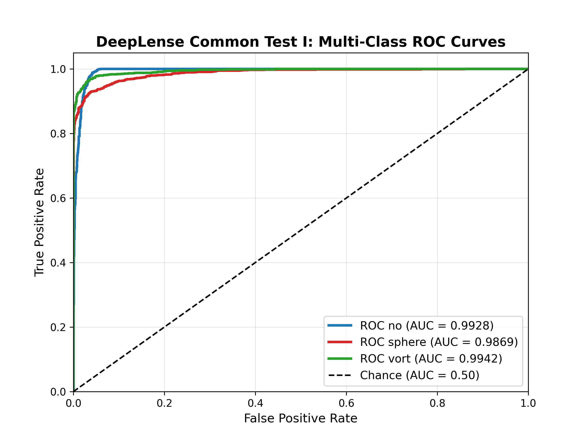
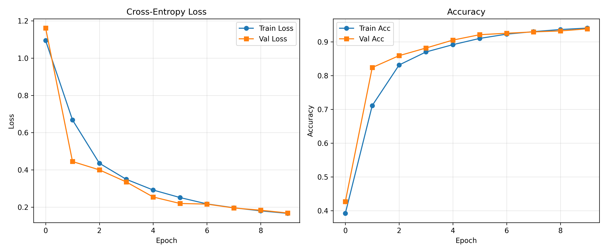
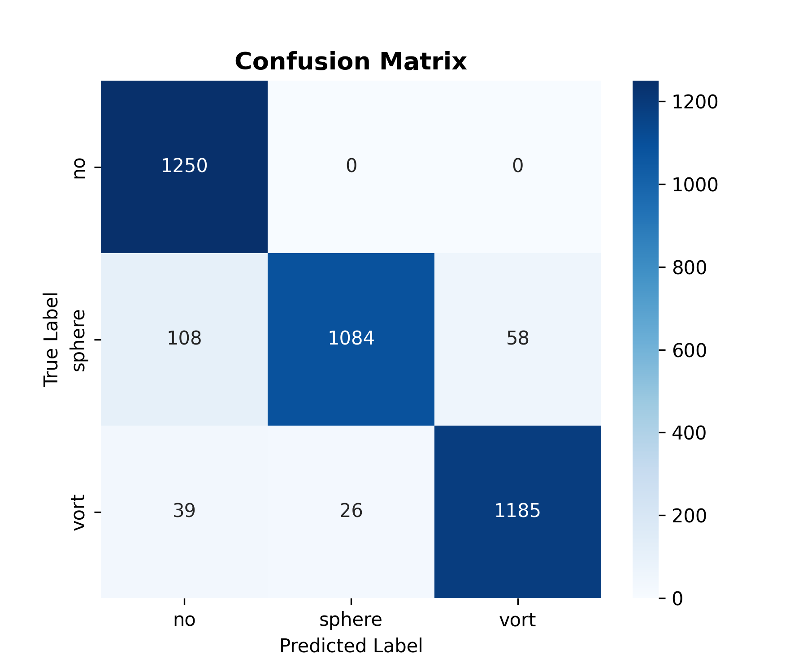

# ML4SCI DeepLense: GSoC Evaluation Tests

[](https://www.python.org/downloads/)
[](https://pytorch.org/)
[](https://www.kaggle.com/code/muntasirmamun396/ml4sci-deeplense-common-test-1)
[]()
[](https://opensource.org/licenses/MIT)

**Applicant:** Muntasir Mamun  
**Organization:** Machine Learning for Science (ML4SCI)  
**Project:** DeepLense (Deep Learning for Strong Gravitational Lensing)  
**Kaggle Kernel:** [ml4sci-deeplense-common-test-1](https://www.kaggle.com/code/muntasirmamun396/ml4sci-deeplense-common-test-1)

---

## 🌌 Overview

Strong gravitational lensing occurs when massive foreground galaxies deflect light from background cosmic sources. Substructures within dark matter halos—such as smooth mass distributions, cold dark matter subhalos, and vortex perturbations—leave subtle geometric signatures on Einstein rings and arcs.

This repository provides full end-to-end solutions for the **ML4SCI DeepLense** evaluation benchmarks:
1. **Common Test I:** Multi-class deep learning classification distinguishing smooth lenses, spherical subhalos, and vortex substructures with PyTorch on GPU.
2. **Specific Test II:** Agentic AI workflow for autonomous simulation orchestration, parameter validation, and tool calling via Pydantic schemas.

---

## 📊 Common Test I: Multi-Class Classification

### 1. Benchmark Results Summary

Trained for 10 epochs on Kaggle GPU across **37,500 simulation samples** with a rigorous 90:10 stratified split (**33,750 train**, **3,750 validation**).

| Metric | Score |
| :--- | :--- |
| **Macro-Average ROC-AUC** | **`0.9913` (99.13%)** |
| **Class `no` (No Substructure) AUC** | **`0.9928`** |
| **Class `sphere` (Subhalo) AUC** | **`0.9869`** |
| **Class `vort` (Vortex) AUC** | **`0.9942`** |
| **Overall Validation Accuracy** | **`94.00%`** |
| **Best Validation Loss** | **`0.1689`** |

#### Detailed Classification Report (Hold-Out Validation Set)
```
              precision    recall  f1-score   support

          no       0.89      1.00      0.94      1250
      sphere       0.98      0.87      0.92      1250
        vort       0.95      0.95      0.95      1250

    accuracy                           0.94      3750
   macro avg       0.94      0.94      0.94      3750
weighted avg       0.94      0.94      0.94      3750
```

---

### 2. Evaluation Visualizations

#### Multi-Class ROC Curves


#### Learning Curves (Cross-Entropy Loss & Accuracy)


#### Confusion Matrix


---

### 3. Architecture & Physical Invariance Design
* **Rotational & Reflective Symmetry:** Astronomical lensing images are orientation-invariant. Data augmentation enforces $D_4$ dihedral symmetry ($90^\circ$ rotation steps, horizontal & vertical reflections) to prevent orientation-biased spurious correlations.
* **Backbone:** ResNet-50 feature extractor with ImageNet weights.
* **Projection Head:** 2048-dim representation projected to 256 dimensions with Batch Normalization, ReLU activation, and Dropout ($p=0.3$) for regularization.
* **Optimization:** AdamW optimizer ($\text{lr} = 10^{-4}, \text{weight\_decay} = 10^{-2}$) scheduled with Cosine Annealing (`T_max=10`).

---

## 🤖 Specific Test II: Agentic AI Workflow

Implemented in [`Test_II_Agentic_AI_Simulation.py`](Test_II_Agentic_AI_Simulation.py):
* **Pydantic Validation:** Strict validation of simulation parameters (`substructure_type`, `simulation_model`, `redshift_lens`, `redshift_source`, `num_images`).
* **Tool Calling Execution:** Safe routing between user natural language intent and simulation backends.
* **Human-in-the-Loop Fallback:** Interactive clarification prompts triggered when parameters are out of physical bounds.

To run Test II locally:
```bash
python3 Test_II_Agentic_AI_Simulation.py
```

---

## 🛠️ Reproduction & Installation

```bash
git clone https://github.com/muntasir-396/ML4SCI-DeepLense-GSoC-Test.git
cd ML4SCI-DeepLense-GSoC-Test
pip install -r requirements.txt
```

To run the classification notebook:
```bash
jupyter notebook Common_Test_I_Classification.ipynb
```
